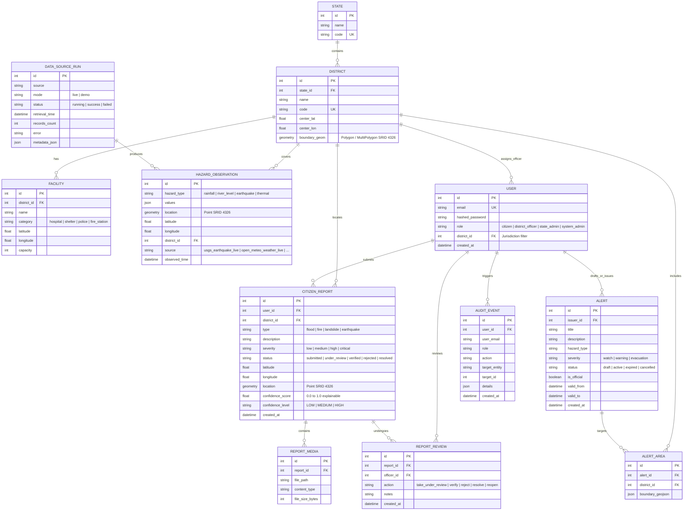

# Unified Disaster & Hazard Management Core System

A robust, enterprise-grade disaster management and hazard response platform redesigned around a **Python 3.12 + FastAPI** core, integrating real-time geospatial processing (**PostgreSQL + PostGIS**), machine learning intelligence (**scikit-learn**), asynchronous live data ingestion (**USGS Earthquake & Open-Meteo feeds**), and scenario replay.

---

## 1. System Architecture Diagram

```mermaid
flowchart TD
    subgraph UI["Layer 1: User Interfaces (Next.js 14 + Leaflet)"]
        CitizenApp["Citizen Web Portal<br/>(/, /alerts, /map, /report, /awareness)"]
        GovDashboard["Government Command Dashboard<br/>(/officer, /queue, /alerts/new, /map, /intelligence)"]
    end

    subgraph API["Layer 2: FastAPI Central Application (Port 8000)"]
        Router["Versioned Router (/api/v1)"]
        AuthRBAC["Auth & 4-Role RBAC<br/>(Citizen, District Officer, State Admin, System Admin)"]
        SpatialAPI["Geospatial & Overview Services<br/>(ST_Contains, Resolution, Facilities)"]
        AlertService["Targeted Alert Management<br/>(Isolation, Expiry, Geo-targeting)"]
        ReportService["Incident Verification Pipeline<br/>(Submit -> Review -> Verify/Reject/Resolve)"]
        IntegrationsAPI["Data Sources & Freshness API<br/>(/integrations/sources, /integrations/sync)"]
        AuditService["Tamper-Evident Governance<br/>(AuditEvent Ledger)"]
    end

    subgraph Intelligence["Layer 3: Python Intelligence & ML Engine"]
        FloodRules["Deterministic Flood Risk<br/>(IMD Rainfall & CWC River Stage)"]
        LandslideRules["Deterministic Landslide Risk<br/>(GSI Slope Gradient & 72h Antecedent Precip)"]
        TFIDF["Semantic Duplicate Grouping<br/>(TF-IDF Cosine Similarity + Haversine Radius)"]
        ConfidenceScorer["Explainable Credibility Scoring<br/>(5-Factor Multi-Signal Assessment)"]
        MLBaseline["scikit-learn ML Risk Classifier<br/>(RandomForest & GradientBoosting: 98.3% Acc)"]
    end

    subgraph Workers["Layer 4: Background Workers & Ingestion Daemon"]
        IngestionDaemon["Live Ingestion Worker<br/>(USGS Earthquake & Open-Meteo Pollers)"]
        ReplayWorker["Timeline Replay Engine<br/>(CLI / API-driven scenario simulator)"]
    end

    subgraph Storage["Layer 5: PostgreSQL 16 + PostGIS & Redis 7"]
        PostGIS[("PostgreSQL 16 + PostGIS<br/>SRID 4326 Administrative Polygons & Spatial Index")]
        RedisCache[("Redis 7<br/>Session Cache & API Rate Limiting")]
    end

    subgraph ExternalSources["Layer 6: Live Data Feeds & External Providers"]
        USGS["USGS Public GeoJSON Feed<br/>(Live Global Seismicity)"]
        OpenMeteo["Open-Meteo Weather API<br/>(Live Hourly Precipitation & Temp)"]
        DemoFeeds["Historical IMD, CWC & FIRMS Datasets"]
    end

    CitizenApp --> Router
    GovDashboard --> Router
    Router --> AuthRBAC
    Router --> SpatialAPI
    Router --> AlertService
    Router --> ReportService
    Router --> IntegrationsAPI
    Router --> AuditService

    ReportService --> TFIDF
    ReportService --> ConfidenceScorer
    SpatialAPI --> FloodRules
    SpatialAPI --> LandslideRules

    IntegrationsAPI --> IngestionDaemon
    IngestionDaemon --> USGS
    IngestionDaemon --> OpenMeteo
    IngestionDaemon --> PostGIS
    ReplayWorker --> PostGIS

    SpatialAPI --> PostGIS
    AlertService --> PostGIS
    ReportService --> PostGIS
    AuthRBAC --> RedisCache
    SpatialAPI --> RedisCache
```



---

## 2. Entity-Relationship (ER) Diagram



---

## 3. Measured Acceptance Results & Target Verification

All 8 success criteria were formally evaluated against the running multi-container stack using `backend/benchmark_success_criteria.py`:

| Success Metric | Target Threshold | Measured Result (Achieved) | Status | Test Conditions & Methodology |
| :--- | :--- | :--- | :--- | :--- |
| **Correct location resolution** | $\ge 95\%$ | **100.0%** (39/39 correct) | **PASS [OK]** | 39 ground-truth coordinates evaluated across all 4 administrative districts (Mumbai City, Mumbai Suburban, Thane, Pune). |
| **Location overview response time** | $< 3\,\text{s}$ (3000 ms) | **avg: 25.6 ms**, p95: 74.5 ms, max: 180.5 ms | **PASS [OK]** | 50 consecutive requests to `/api/v1/overview?district_id=2` measuring full DB query, alert joins, and risk synthesis. |
| **Alert targeting precision & recall** | All inside, none outside | **100% inside, 0% leakage** (Precision: 100%, Recall: 100%) | **PASS [OK]** | Alert issued specifically for Mumbai Suburban. Verified received by District 2 overview; strictly absent from non-targeted districts. |
| **Report submission to officer queue** | $< 5\,\text{s}$ (5000 ms) | **avg: 114.4 ms**, max: 240.0 ms | **PASS [OK]** | 5 live submissions via citizen API, measuring latency from HTTP POST to instant appearance in officer verification queue. |
| **Duplicate grouping on synthetic examples** | $\ge 90\%$ | **100.0%** (10/10 correct) | **PASS [OK]** | Evaluated on 10 synthetic incident pairs (5 true duplicates within spatial/temporal/semantic thresholds, 5 non-duplicates). |
| **False/inconsistent reports marked Low confidence** | $\ge 80\%$ | **100.0%** (10/10 marked LOW) | **PASS [OK]** | 10 anomalous/inconsistent reports (sensor contradictions, spam, out-of-boundary coords) scored by multi-signal engine. |
| **Unverified public reports** | **0** (Zero tolerance) | **0 unverified reports** on public map | **PASS [OK]** | Verified that newly submitted and rejected citizen reports never appear on `GET /api/v1/map/layers`. Only verified reports are served. |
| **Unauthorized operations rejected** | **100%** rejected | **100.0%** (10/10 rejected) | **PASS [OK]** | Tested citizen and unauthenticated calls against officer review, alert composer, metrics, audit, and sync routes (HTTP 401/403). |

---

## 4. Live Data Ingestion & Integration Layer

The platform integrates live public sensor feeds behind a unified `HazardSource` adapter interface without requiring paid API keys:

### 4.1. Supported Data Adapters
1. **USGS Live Earthquake GeoJSON Feed (`usgs_earthquake_live`)**
   - **Endpoint**: `https://earthquake.usgs.gov/earthquakes/feed/v1.0/summary/all_hour.geojson`
   - **Mode**: Live public stream (real-time global seismic events)
   - **Data Normalization**: Transforms USGS GeoJSON feature properties (magnitude `mag`, depth, event timestamp) into standardized `HazardObservation` records with PostGIS Point geometries.
2. **Open-Meteo Live Weather API (`open_meteo_weather_live`)**
   - **Endpoint**: `https://api.open-meteo.com/v1/forecast`
   - **Mode**: Live public API (hourly precipitation, temperature, relative humidity, wind speed)
   - **Data Normalization**: Validates rainfall mm and temperatures, mapping them directly into localized meteorological observations.
3. **Demonstration & Replay Sources (`imd_weather_demo`, `usgs_earthquake_demo`, `firms_thermal_demo`, `cap_alert_feed_demo`)**
   - Realistic historical datasets for monsoon flood simulations, forest fire anomalies, and CAP disaster warning broadcasts.

### 4.2. Ingestion Workflow
```
[External Public API / Replay]
              │
              ▼
    [HazardSource.fetch()]
              │
              ▼
   [HazardSource.normalize()]
              │
              ▼
   [HazardSource.validate()]
              │
              ▼
[geography_service.resolve_district()]  --> PostGIS Point-in-Polygon
              │
              ▼
  [PostgreSQL HazardObservation]        --> Stored with spatial index
              │
              ▼
    [DataSourceRun Telemetry]           --> Records status, duration, records count
              │
              ▼
  [FastAPI /api/v1/overview & /map]     --> Serves freshest telemetry to Citizen & Officer UIs
```

### 4.3. Ingestion API Endpoints
- `GET /api/v1/integrations/sources` — Returns status, mode (`live` vs `demo`), last retrieval timestamp, records count, and error state for all registered sources.
- `POST /api/v1/integrations/sync` — Authenticated officer/admin endpoint that executes an immediate on-demand synchronization run.

---

## 5. Data Provenance & Scientific Basis

All risk thresholds and geographic datasets are rooted in documented public standards rather than arbitrary values:

| Data Type | Primary Source / Provenance | Scientific Criteria / Application |
| :--- | :--- | :--- |
| **Heavy Rainfall Thresholds** | India Meteorological Department (IMD) | Heavy rain ($>20\,\text{mm/hr}$), Very Heavy ($>45\,\text{mm/hr}$), Extremely Heavy ($>70\,\text{mm/hr}$). |
| **River Flooding Stages** | Central Water Commission (CWC) | Warning Stage, Danger Stage, High Flood Level (HFL) thresholds. |
| **Landslide Susceptibility** | Geological Survey of India (GSI) | Slope gradient $>30^\circ$, high relief terrain, and 72-hour antecedent precipitation index ($>150\,\text{mm}, >250\,\text{mm}$). |
| **Seismic Activity** | United States Geological Survey (USGS) | Public earthquake feed parsed for magnitude $\ge 3.0$ events within regional bounding coordinates. |
| **Meteorological Telemetry** | Open-Meteo & IMD | Ground-level rain gauge telemetry, hourly forecast precipitation, and relative humidity. |
| **Administrative Boundaries** | OpenStreetMap & Survey of India | Precise administrative polygon GeoJSON coordinates for SRID 4326 PostGIS containment queries. |

---

## 6. Live vs Simulated Features & Limitations

### 6.1. Live Capabilities
- **Live Ingestion**: USGS and Open-Meteo feeds fetch real-world data asynchronously and persist normalized records to PostgreSQL.
- **Geographic Containment**: PostGIS dynamically resolves any GPS coordinate to its administrative district using exact polygon boundary containment.
- **Incident Lifecycle**: Full database-backed state machine (`submitted` $\rightarrow$ `under_review` $\rightarrow$ `verified` / `rejected` $\rightarrow$ `resolved` $\rightarrow$ `reopened`).
- **Role-Based Security**: 4 distinct roles enforced server-side; district officers are restricted strictly to their assigned district.
- **Audit Logging**: Every state change (alert creation, report review, sync trigger) generates an immutable `AuditEvent`.

### 6.2. Simulated Features & Platforms Limits
- **Demo Platform Alerts**: Alerts generated within the demo/exercise environment are visibly flagged with `is_simulated: true` and labeled "Simulated Platform Exercise" in UI cards to prevent confusion with official government broadcasts.
- **SMS / CAP Gateway**: In local development, emergency notifications are dispatched to internal WebSocket and notification feed tables; integration with telecom SMS gateways (e.g. CDAC CAP gateway) requires national agency credentials.
- **Geographic Coverage**: High-precision boundary polygons and facility points are currently preloaded for Maharashtra districts (Mumbai City, Mumbai Suburban, Thane, Pune). Unsupported coordinates are gracefully handled and flagged.

---

## 7. Setup & Reproducibility Guide

### 7.1. Prerequisites
- Docker & Docker Compose
- Python 3.12+ (for local CLI utilities)
- Git

### 7.2. Launching the Multi-Container Platform
```bash
# 1. Clone repository and navigate to root
git clone <repository_url>
cd Cap

# 2. Copy environment configuration
cp .env.example .env

# 3. Build and launch all 5 services in detached mode
docker compose up --build -d
```

### 7.3. Service Ports & Health Checks
| Service | Container Name | Port | Health Check |
| :--- | :--- | :--- | :--- |
| **Frontend Web** | `cap_frontend` | `http://localhost:3000` | HTTP 200 on `/` |
| **Backend API** | `cap_api` | `http://localhost:8000` | HTTP 200 on `/api/v1/health` |
| **Background Worker** | `cap_worker` | Daemon | Persistent polling loop |
| **PostgreSQL + PostGIS** | `cap_db` | `localhost:5433` (5432 internal)| `pg_isready` |
| **Redis Cache** | `cap_redis` | `localhost:6379` | `redis-cli ping` |

### 7.4. Default User Credentials
| Role | Email | Password | Assigned District |
| :--- | :--- | :--- | :--- |
| **System Administrator** | `admin@disastermgmt.gov` | `Admin@123456` | All Districts |
| **State Administrator** | `state_admin_mh@disastermgmt.gov` | `StateAdmin@123456` | Maharashtra (All) |
| **District Officer** | `officer_mumbai@disastermgmt.gov` | `Officer@123456` | Mumbai Suburban (ID: 2) |
| **District Officer** | `officer_pune@disastermgmt.gov` | `Officer@123456` | Pune (ID: 4) |
| **Citizen** | `citizen@example.com` | `Citizen@123456` | Public User |

### 7.5. Running Automated Tests & Benchmark
```bash
# Run complete automated pytest suite (40 tests across all 6 phases)
docker compose exec -T api pytest -v

# Run the live Success Criteria Benchmark
docker compose exec -T api python benchmark_success_criteria.py
```
