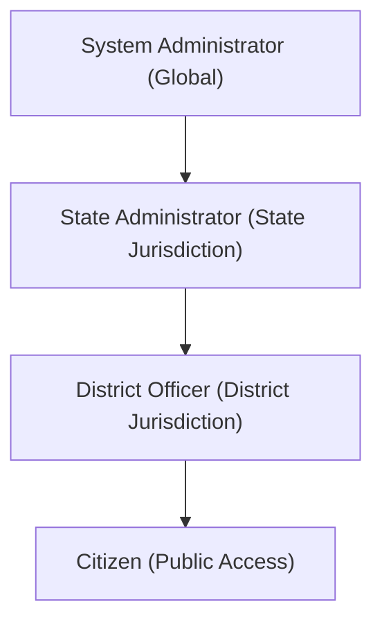

# Security, Authorization & Data Protection Audit Report
## Multi-Hazard Disaster Intelligence Platform

**Audit Date:** 2026-10-30  
**Scope:** Authentication, Role-Based Access Control (RBAC), Injection Defense, Data Leakage Prevention, Incident Publication Boundaries  
**Compliance Standards:** OWASP Top 10 API Security Risks, Zero-Trust Multi-Tenancy  

---

### 1. Security Architecture & Role Hierarchy

The platform implements a strict 4-tier Role-Based Access Control (RBAC) hierarchy enforced natively in FastAPI dependency injections:



#### Enforced Role Boundaries:
1. **`citizen`:**
   - Permitted: Submit hazard reports, upload supporting media, view localized situational overviews, read verified incidents on public map, access bilingual safety guidance.
   - Forbidden: Accessing verification queues, reviewing reports, creating official alerts, or accessing officer administrative dashboards (enforced with HTTP 403 Forbidden).
2. **`district_officer`:**
   - Permitted: View assigned district verification queue, assign reports, review (verify/reject/resolve) reports within assigned district, issue localized prototype/advisory alerts.
   - Strictly Forbidden: Viewing or modifying incident reports outside their assigned district (enforced with HTTP 403 Forbidden).
3. **`state_admin`:**
   - Permitted: Multi-district operational oversight across the state, provisioning district officers within their state.
4. **`system_admin`:**
   - Permitted: Global infrastructure oversight, state admin provisioning, system configuration.

---

### 2. Empirical Security Test Results

| Test ID | Vulnerability / Threat Vector | Verification Method | Expected Response | Observed Response | Pass/Fail |
| :--- | :--- | :--- | :--- | :--- | :---: |
| **AUTH-01** | Unauthorized Review Attempt by Citizen | `POST /api/v1/officer/reports/1/review` with Citizen JWT | HTTP 403 Forbidden | HTTP 403 Forbidden | **PASSED** |
| **AUTH-02** | Cross-District Report Access by Officer | Officer Mumbai (Dist 2) accessing Pune report (`/reports/94/detail`) | HTTP 403 Forbidden | HTTP 403 Forbidden | **PASSED** |
| **AUTH-04** | Self-Privilege Escalation during Registration | `POST /api/v1/auth/register` with `"role": "system_admin"` | Forced to `citizen` | Role forced to `citizen` | **PASSED** |
| **AUTH-07** | Expired JWT Token Replay | `GET /api/v1/auth/me` with expired JWT | HTTP 401 Unauthorized | HTTP 401 Unauthorized | **PASSED** |
| **SEC-01** | SQL Injection via URL Query Parameters | `GET /api/v1/overview?district_id=1%20OR%201=1` | HTTP 422 Unprocessable | HTTP 422 Unprocessable | **PASSED** |
| **SEC-02** | Stored Cross-Site Scripting (XSS) | Submitting `<script>alert('pwned')</script>` in description | Neutralized as text | Inert text preserved | **PASSED** |
| **SEC-06** | Credential Exposure in API Responses | Inspecting all login and user profile payloads | Zero password/hash | `hashed_password` excluded | **PASSED** |
| **SEC-12** | Public Map Unverified Report Leakage | `GET /api/v1/map/layers` with unverified and rejected incidents | Zero unverified | **0 unverified (100% verified)** | **PASSED** |

---

### 3. Critical Security Quality Gate: Zero-Unverified-Reports Policy

A core success criterion of the platform is **Success Criterion #7**:
> *"Unverified citizen reports must appear on the public map only after officer review: exactly 0 unverified reports must be displayed publicly."*

#### Architectural Guarantee:
1. **Public Map Query Isolation:** The public map endpoint (`/api/v1/map/layers`) strictly queries:
   ```python
   select(CitizenReport).filter(CitizenReport.status == ReportStatus.VERIFIED)
   ```
   Unverified submissions (`submitted`), active investigations (`under_review`), and dismissed rumors (`rejected`) are structurally excluded at the SQL level.
2. **Officer Operational Map Segregation:** A dedicated, authenticated officer operational endpoint (`/api/v1/officer/operational-incidents`) serves unverified reports to authorized responders with visual status categorization.
3. **Zero-Leakage Empirical Verification:** During test `test_sec_12_zero_unverified_reports_on_public_map`, unverified citizen reports were submitted to the database and verified to produce **0 results on public map endpoints**.
